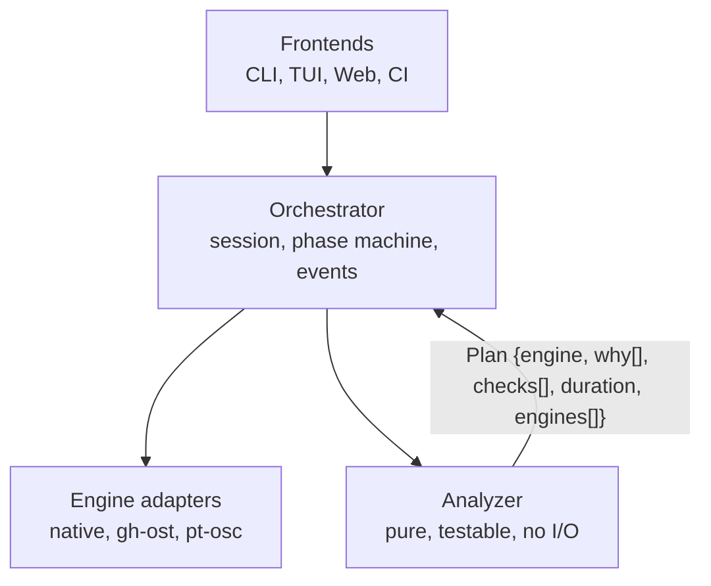
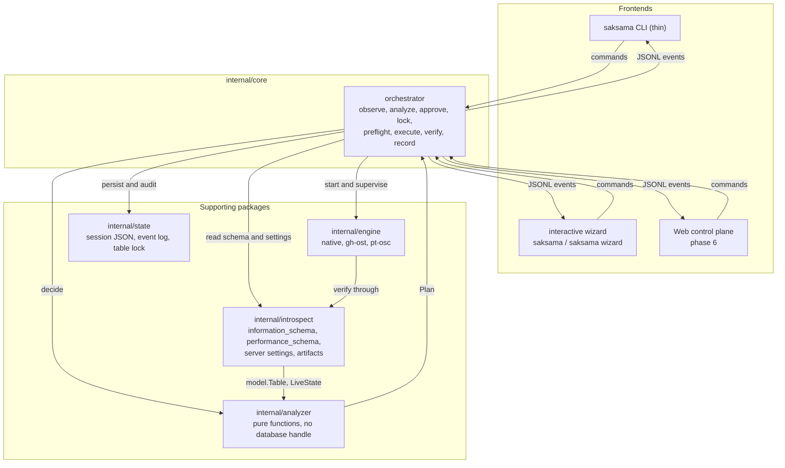
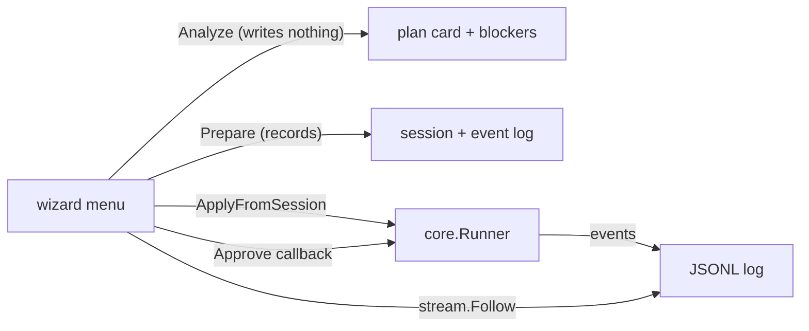

# Saksama Core: zero-downtime schema migration for teams without blue-green

> **Design doc.** Status: draft, evolving with the implementation.
> **Date:** 2026-11-04
> **Origin:** a hand-written `migrate.sh` wrapper around pt-osc, plus the research in this file.
> The script is archived at [docs/historical/migrate.sh](docs/historical/migrate.sh); it is evidence, not a tool.
> **Product name:** **Saksama Core**, binary `saksama`. The naming rationale is in the README.

---

## 1. Summary

An open source tool for backend developers and startup founders who:

- have **one MySQL instance** (no replica), on one box shared with the app or on a second VPS of their own
- **cannot afford** blue-green deployment, in money or in engineering time
- still need schema migrations with effectively no downtime
- are **not** MySQL internals experts

**The name:** Saksama is Indonesian for meticulous, careful. The register is formal, the same shelf as *semenjana*, which fits a product that sells "inspect carefully before you change anything".

**Positioning (not a "gh-ost wrapper"):**

> Analysis, decision, guardrail, and recovery for **online schema change on one instance**.
> The engine may be borrowed. The policy is ours.

**Three differences from what exists:**

| # | Difference | Why nobody has this today |
|---|---|---|
| 1 | **Analyzer**: predict the MySQL error *before* it happens (FK charset and collation, key length under utf8mb4, a foreign-key column being altered, metadata lock blocking, RDS and Aurora privilege limits) | pt-osc and gh-ost report these *after* the migration is already partly done |
| 2 | **Engine matrix**: tell you whether gh-ost or pt-osc fits *this table*, with the evidence and the trade-offs | every existing tool assumes you already know |
| 3 | **Honest recovery**: state what is recoverable at each phase, and never promise a rollback that discards writes | engines leave artifacts behind without explaining what is safe |

---

## 2. Context and target user

**Target:** a backend developer or startup founder who:

- runs **one or two VPS**, self-managed: the app and MySQL stacked on one box, or split one app / one database
- does **not** run managed MySQL: RDS and its equivalents are the bill that got cut first
- has **no replica**, or has not set one up
- has **no DBA** and no blue-green
- needs `ADD INDEX`, `ADD COLUMN`, or `CHANGE COLUMN` on a large production table, for example 59 million rows

**Not the target:** large companies with a platform team and their own tooling.

**Why this user exists:**

- Most startups run **one instance**. This is not an edge case, it is the default. Sometimes everything on one box; more often the app on one VPS and MySQL on another, both self-managed, because managed MySQL is a monthly bill the budget never had.
- Blue-green bills this user twice. **The instance:** a second server, paid every month whether or not a migration is running. **The change:** dual writes, two deploy cycles, traffic switching, a rollback plan, paid in salary or in features that do not ship. This user is short on both, and the cash is the binding constraint. That is why the only safe route to a large `ALTER` looks like a third server plus a rewrite of the deploy.
- What is actually needed is **online schema change on the instance they already run**. Same server, same app, one deploy, a cheap operation, provided it is done correctly.

> **Reframing:** "single server, therefore unsafe" is the wrong frame.
> Online DDL on one instance is not a hack. The hack is a migration with no analysis, no guardrail, and no recovery plan.
> The product is the correct procedure, packaged as a tool.

---

## 3. Landscape and the gap

| Tool | What it is | Where it falls short | What we add |
|---|---|---|---|
| `pt-online-schema-change` | Copy-based online schema change, Perl | Needs Perl and DBD::mysql, GPL-2, cryptic errors, no cutover pause, "resume" means re-run | Guardrails, planning, recovery |
| `gh-ost` | Copy-based, Go, one binary | **No foreign key support at all**, single-column keys, no dry run, many options | Analyzer, engine matrix, orchestration |
| Native MySQL DDL | `INSTANT` and `INPLACE, LOCK=NONE` | Only some operations, no planning, no throttle | **Routing to native is the most valuable feature** |
| `CLONE` plugin | Physical instance clone | Not a table primitive, needs a donor | Out of scope, documented as such |
| Existing wrappers | Shell scripts | FK actions silently lost, state in `/tmp`, password in argv | The core of this product |
| Flyway, Liquibase | Versioned migrations | Not an online schema change tool | Different category |

**The gap:** the last mile between "I want to add an index" and "the migration finished safely". Existing tools are written for people who already understand them.

---

## 4. Engine comparison

### 4.1 pt-osc versus gh-ost

| Aspect | pt-osc | gh-ost |
|---|---|---|
| Language and dependencies | Perl, DBI, DBD::mysql | Go, one static binary |
| License | **GPL-2** | **MIT** |
| Copy source | Primary | Replica by default, `--allow-on-master` on a single server |
| Key requirement | primary or unique, composite fine | single-column only |
| UUID primary key | works, chunking uneven | works, chunking very uneven |
| Foreign keys on the altered table | handled natively in 3.x | **not supported at all** |
| Foreign keys referencing the table | must be dropped manually | impossible |
| Throttling | `--max-load`, `--critical-load` | plus `--max-lag`, `--throttle-control-replicas` |
| **Cutover pause** | no | yes, by flag file |
| Dry run | `--dry-run` copies for real | `--dry-run` for a preview |
| Resume | 3.x only, with specific first-run flags | no |
| Extra requirement | Perl stack | binlog ROW, FULL row image |

### 4.2 MySQL versions

| MySQL | Native INSTANT | Native INPLACE | gh-ost | pt-osc |
|---|---|---|---|---|
| 5.6 | no | `ADD INDEX` | yes, with `--skip-metadata-lock-check`: `performance_schema.metadata_locks` does not exist, so gh-ost cannot check the lock queue and refuses to start unless told to skip it | 3.x |
| 5.7 | no | `ADD INDEX` | yes | 3.x |
| 8.0.12 to 8.0.28 | add column | `ADD INDEX` | yes | 3.x |
| 8.0.29+ | add and drop column | `ADD INDEX` | yes | 3.x |
| Aurora | yes | yes | yes with care | `foreign_key_checks=0` is unavailable |
| RDS | yes | yes | needs `rds_superuser` | needs `rds_superuser` |

### 4.3 The CLONE plugin is not a table engine

`CLONE INSTANT FROM donor` performs a physical instance clone. It is fast, requires a donor instance, and is not a per-table operation. It is deliberately absent from the engine ladder.

---

## 5. Architectural principles



1. **The analyzer is a pure function.** No database handle, fully unit testable, usable offline as a CI gate, the single source of truth for every frontend.
2. **Policy is not execution.** The copy engine is a commodity. The decision, the guardrail, and the recovery are the product.
3. **Fail closed by default.** An operation that is not understood becomes a blocker, not a guess.
4. **Never parse engine output for progress.** Poll the database. Engine stderr is for diagnosis only.
5. **Engines run under the core, never under the UI.** A dropped SSH session must not kill a migration.
6. **A frontend holds no policy.** The CLI, the wizard, and a future web UI render what the analyzer decided and call the core for everything else. A frontend that decides whether a change is safe is a second, quieter set of rules.
7. **A question writes nothing.** `Analyze` observes and decides; `Prepare` records. Advise, previews, and a dashboard opening ten tables must use the former, or the state directory fills with sessions nobody asked for.

---

## 6. System shape



| Package | Responsibility | Never |
|---|---|---|
| `internal/cli` | flag parsing, dispatch, exit codes | decides whether a change is safe |
| `internal/wizard` | numbered menus, prompts, the same commands printed before acting | owns policy, or downloads anything |
| `internal/app` | connection and state-directory wiring shared by both frontends | business rules |
| `internal/core` | Analyze (writes nothing), Prepare, Apply, Cancel, Cleanup, Reconcile, engine ownership and verification | prints |
| `internal/analyzer` | pure decision layer: `(schema, ops, server, liveState) -> Plan` | touches a database |
| `internal/introspect` | information_schema, performance_schema, settings, artifact discovery | decides |
| `internal/engine` | native, gh-ost, pt-osc adapters; progress polled from the database | parses engine logs for state |
| `internal/enginesetup` | the one place that downloads and writes an executable (verified version, checksum, pinned digest), and the one place that knows which package manager the host has | runs from plan, advise, or apply; invents no package name it cannot map |
| `internal/stream` | tails an event log from a sequence number, for `attach` and the wizard | buffers unbounded |
| `internal/state`, `internal/events`, `internal/render`, `internal/support` | session records, the event contract, presentation, the verified-claims table | — |

The event contract is one way for commands and the other way for events, which is
what makes a TUI, a web UI, and a CI job equal citizens rather than three
implementations of the same logic.

## 7. The analyzer

### 7.1 Parse the ALTER into operations

A deliberately small tokenizer, not a full SQL parser. Supported: `ADD INDEX`, `ADD UNIQUE`, `ADD COLUMN`, `DROP COLUMN`, `MODIFY`, `CHANGE`, `RENAME COLUMN`, `RENAME TO`, `ADD` and `DROP PRIMARY KEY`, `CONVERT TO CHARACTER SET`, `ENGINE=`, `ALTER COLUMN SET/DROP DEFAULT`, plus `ALGORITHM=` and `LOCK=`. Anything else becomes `OpUnknown`, which is a blocker.

### 7.2 Introspect the server

Columns, indexes, primary key shape, foreign keys in both directions with their actions, triggers, table and index size, row format, partitioning, active queries, open transactions, metadata locks, replica state, grants, leftover artifacts, and the server settings listed in section 6.5.

### 7.3 Check catalog

Every check has a stable ID, a severity, the MySQL error it prevents, and an actionable remediation. The catalogue lives in [`docs/CHECKS.md`](docs/CHECKS.md) and covers charset and collation, index shape, foreign keys, operational hazards, engine capabilities, engine selection, and server settings.

### 7.4 Duration estimates

A single number is a lie. Every estimate is a range, a confidence label, and the basis:

- historical profile from local sessions (planned, not built),
- a bounded read-only benchmark (planned),
- a heuristic fallback, labelled as such.

### 7.5 The server-settings doctor

`advise` reads the variables the engines depend on and shows them next to what is required: `log_bin`, `binlog_format`, `binlog_row_image`, `server_id`, `read_only`, `super_read_only`, `performance_schema`, `transaction_isolation`, `sql_require_primary_key`, `innodb_file_per_table`, `lower_case_table_names`, `gtid_mode`.

Settings are a second axis, separate from suitability. An engine can suit a table perfectly and still refuse to start. Unknown is never treated as a pass.

### 7.6 Routing

```
1. every operation has a verified native rule          -> native
2. a rebuild is needed, gh-ost fits and can start      -> gh-ost
3. a rebuild is needed, gh-ost does not fit or cannot
   start, pt-osc fits                                  -> pt-osc
4. nothing fits                                        -> refuse, and say why per engine
```

A recorded operator choice overrides the automatic pick and is then judged on its own merits: if the chosen engine cannot run, the plan refuses with the setting to fix, naming the engine.

---

## 8. Safety policy

| Situation | Default |
|---|---|
| no primary or unique key | **BLOCK** when a rebuild is needed |
| a running statement older than the threshold | WARN, then **BLOCK** at 300 seconds |
| pending metadata lock | **BLOCK** |
| FK column charset or collation mismatch | **BLOCK** (error 3780) |
| foreign key changes | **BLOCK**: out of scope in v1 |
| disk below twice the table size | **BLOCK** when measured |
| server read-only | **BLOCK** |
| engine binary missing | **BLOCK**, with the install hint |
| server not configured for the engine | **BLOCK**, with the setting to change |
| target marked production | WARN plus a required hostname confirmation |

---

## 9. Recovery

Before a cutover, cancel and cleanup are safe: the production table has not been swapped. After a cutover, new writes live only in the new table, so the tool says "forward migration" rather than offering a rename that would discard writes. Metadata snapshots are kept for audit and for a recovery performed under a write freeze.

---

## 10. Interactive frontends on a server

The interactive frontend is a **line-based wizard**, not a full-screen TUI: numbered
menus, a text prompt, and the equivalent non-interactive command printed before
anything happens.



| Reality | Implication |
|---|---|
| SSH drops | the core owns the engine, not the client; the wizard only reads and asks |
| no TTY | the wizard exits 2 and names the non-interactive command; it never waits on a pipe |
| `TERM=dumb`, locale C | line-based prompts, ASCII output, no raw mode, no arrow keys |
| 80x24 | menus are one line per choice with an optional note, and degrade by truncation |
| no clipboard | every screen prints the command it is equivalent to |
| many admins | the wizard reads the same state directory as the CLI, so both see the same sessions |
| crash | `reconcile` reports what an interrupted session left behind; `--retire` marks a dead attempt failed and releases its lock |

Why not a full-screen TUI: it adds a rendering runtime, needs a pty to test, and
changes shape every time the approval or state model does. The wizard is a thin
layer over commands that already exist, so it is testable with a scripted prompter
and a fake backend, and it cannot drift from the CLI.

## 11. Licensing and distribution

| Component | License | Can it be bundled |
|---|---|---|
| gh-ost | MIT | yes, with its LICENSE |
| pt-online-schema-change | GPL-2 | **no**, invoke as an external binary only |
| Saksama Core | MIT | n/a |

Version detection is mandatory, because a 2019 pt-osc behaves differently from 3.6.

---

## 12. Language choice

Go, for a static binary, `go:embed`, a mature MySQL driver, cheap concurrency for polling, and fast iteration. Rust would be right only if the author were already fluent, or if a future custom engine needed memory control without a GC. The bottleneck is MySQL.

---

## 13. Roadmap

| Phase | Content | State |
|---|---|---|
| 0 | decision log, check catalogue, event contract | done |
| 1 | analyzer, offline plan, JSON and plan card | done |
| 2 | live introspection, native execution, sessions, events, engine matrix, doctor | done |
| 3 | cutover pause, cancel, cleanup, orphan recovery | done |
| 3b | long-lived supervisor with a job queue (needed by a web control plane) | not built |
| 4 | interactive wizard over the core (`saksama`, `saksama wizard`) | done |
| 4b | full-screen TUI, if ever | deliberately not built: the wizard covers the need |
| 5 | pt-osc verified against a real binary, broader platform profiles | partially |
| 6 | web control plane on the same event contract | not started |
| 7 | PostgreSQL | not started |

---

## 14. Findings from auditing the original `migrate.sh`

Archived at [docs/historical/migrate.sh](docs/historical/migrate.sh) - kept for this
audit, not for use.

The original script (816 lines) proved the need and also showed what goes wrong.

| # | Finding | Impact |
|---|---|---|
| 1 | `ON DELETE` and `ON UPDATE` were lost, because the regex stopped before the action clause | the constraint was recreated without cascade, silently changing data semantics |
| 2 | the password was passed as `p="$MYSQL_PWD"` on the command line | visible in `ps` |
| 3 | state lived in `/tmp/fk_recreate.sql` | a lost file means silently missing foreign keys |
| 4 | `mysql -u root` was hardcoded | assumes root |
| 5 | the duration estimate was `rows/chunk/2` | an invented number |
| 6 | `SHOW CREATE TABLE` was parsed with grep | fragile |
| 7 | pt-osc was patched with `sudo sed` | breaks on upgrade, and touches GPL territory |
| 8 | "resume" re-ran everything | honest in the UI, but not a resume |
| 9 | `foreign_key_checks=0` left an orphan window | integrity risk |
| 10 | `lock_wait_timeout` was never set | can hang for 24 hours |

Everything in that list became a rule in this tool, and item 1 in particular is why foreign-key actions are read from structured metadata, never from text.

---

## 15. Risks and non-goals

**Risks:** a wrapper breaks when engine output changes (mitigated by never parsing it); scope creep into writing an engine; a support burden across MySQL versions (mitigated by the capability matrix and version detection); low usage frequency, since teams migrate a few times a month (mitigated by CI integration); one FK bug destroying the project's reputation (mitigated by tests against a real server).

**Non-goals for v1:** writing a copy engine, blue-green or dual writes, logical replication, general backfill, database engines other than MySQL and MariaDB, and any claim of automatic data rollback after a cutover.

---

## 16. Glossary

| Term | Meaning |
|---|---|
| **pt-osc** | `pt-online-schema-change` from Percona Toolkit |
| **gh-ost** | GitHub's MySQL online schema changer |
| **MDL** | metadata lock: a long query holds it, DDL queues behind it, every other query queues behind that |
| **INSTANT** | an algorithm that changes metadata only, from MySQL 8.0.12 |
| **INPLACE** | an algorithm that avoids a full copy, usually with `LOCK=NONE` |
| **shadow table** | the copy an engine builds before swapping |
| **FK action** | `ON DELETE` or `ON UPDATE` behaviour, which must survive any recreation |
| **cutover** | the moment the copy table becomes the real table |
| **hold cutover** | pausing before that moment so a human can verify |
| **throttle** | an engine waiting for `Threads_running` to drop below `--max-load` |
